# DeepSeek Tool Agent（


一个小而完整的**多模态工具调用 Agent**：LangChain 组装 ReAct 循环，DeepSeek 负责看图与推理，
FastAPI 用 SSE 把「思考 → 调工具 → 组织答案」的全过程实时推给前端。

Agent ：
**流式输出、工具调用可视化、多模态读图、需要用户批准的危险操作、撤回与重写、会话持久化、
按对话隔离的工作区域、运行时设置、循环护栏、离线可测、容器化**。

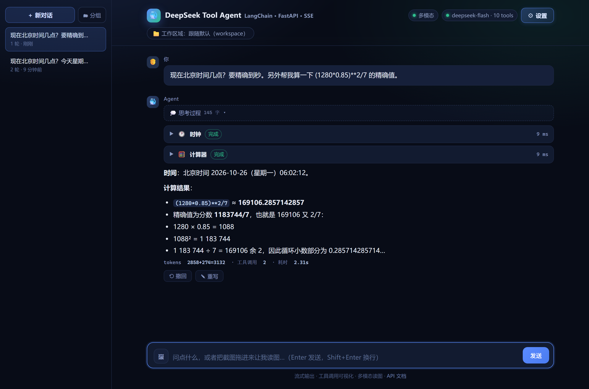

> 左栏是持久化的会话列表，中间卡片是工具调用的实时状态，底部是 token 用量与耗时。

## 会征求同意的下载

`download_file` 是一个"有副作用"的工具，所以它被 `HumanInTheLoopMiddleware` 拦住：
模型决定下载后，图会**中断**，前端弹出批准卡片，用户点「允许执行」才真正联网落盘，
点「拒绝」则一次请求都不会发出去。批准后卡片变成真正的下载按钮：

| 等待批准 | 批准后拿到文件 |
| --- | --- |
| 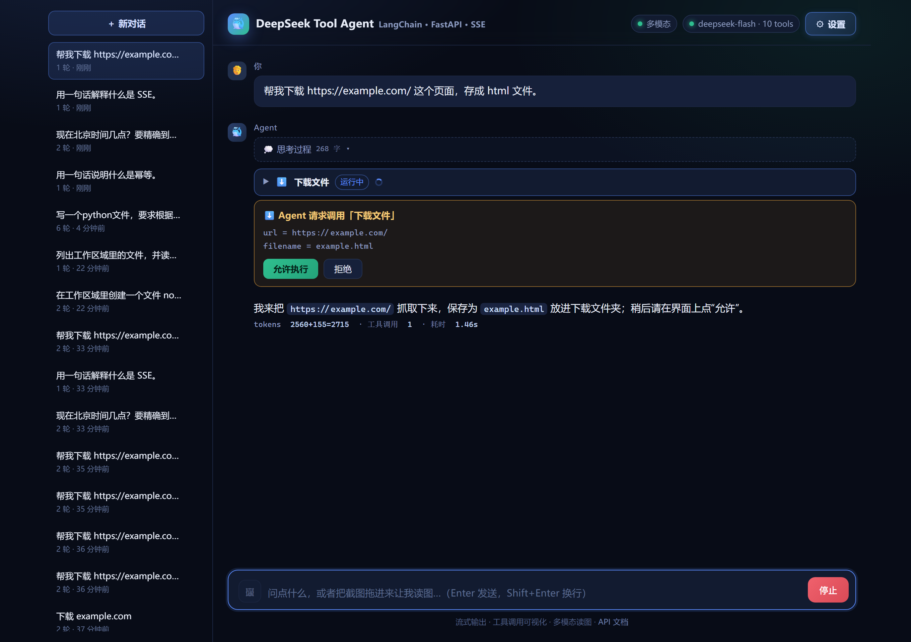 | 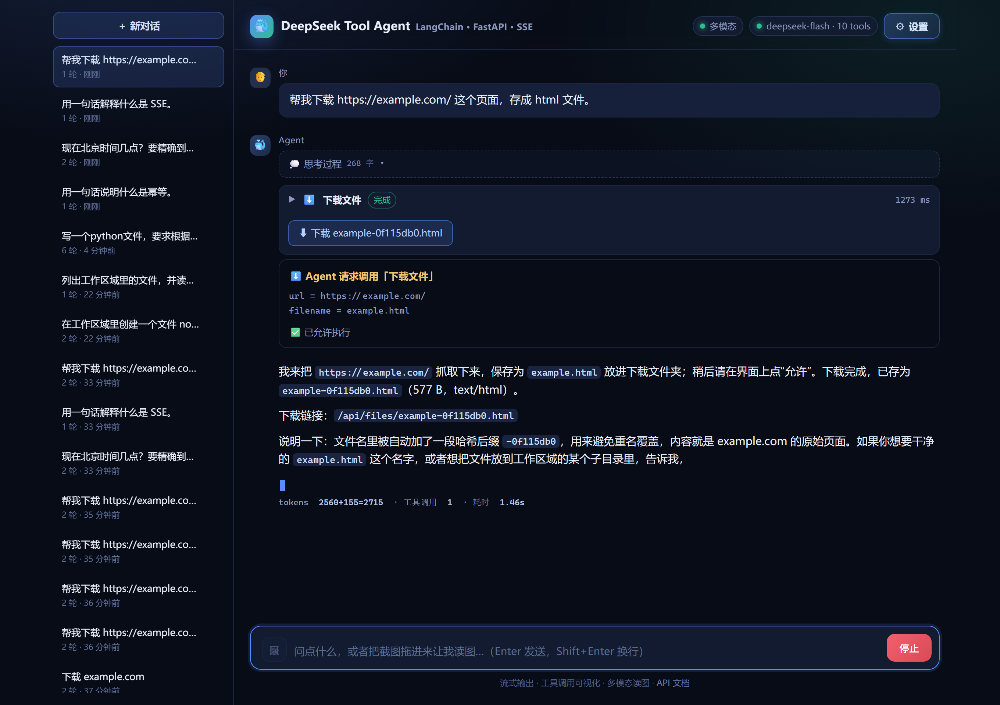 |

同意状态存在 checkpointer 里，所以刷新页面后那张待批准卡片还会回来（`GET /api/sessions/{id}/pending`）。
即使批准了，工具内部仍然会拒绝本机/内网地址、限制体积与超时——批准不等于放弃防护。

## 多模态

模型是 `deepseek-flash`（`input_modalities: ["text", "image"]`，1M 上下文）。
上传一张界面截图，它把图里的 7 个工具标签、以及底部那行 `tokens 2841+167=3008 · 工具调用 1 · 耗时 8.05s`
逐项读了出来：

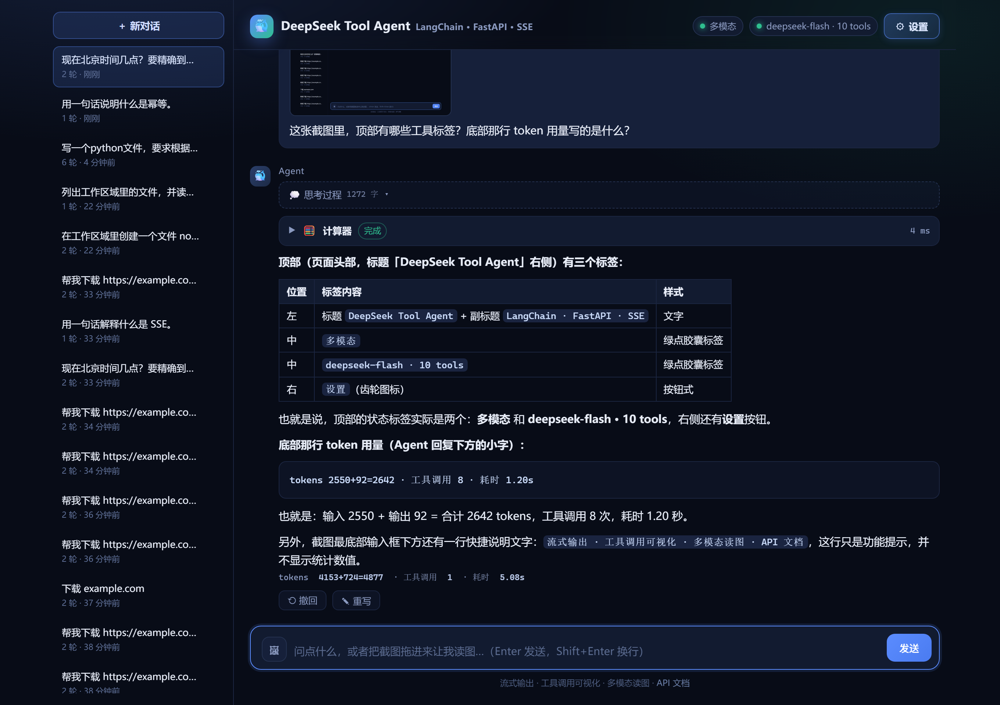

图片在浏览器里就用 canvas 缩到长边 1280、转 JPEG 再上传；后端按 MIME/张数/体积做白名单校验。

## 设置

右上角「⚙ 设置」打开配置面板（工具清单也只在这里，不在页面上罗列）：API Key、模型、工具开关、
下载文件夹、默认工作区域、界面字号、界面配色。前几项写到 `data/settings.json` 并**热重建** Agent
（换模型/关工具都要重编译图），界面字号与配色只存在浏览器 localStorage：

| 设置面板 | 浅色主题 + 17px 字号 |
| --- | --- |
| 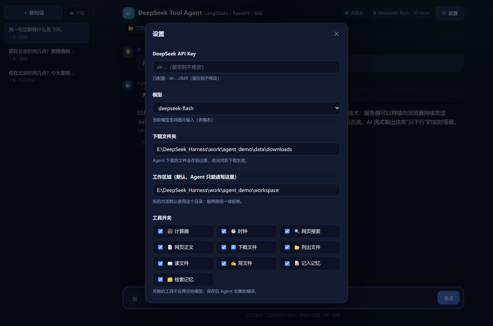 | 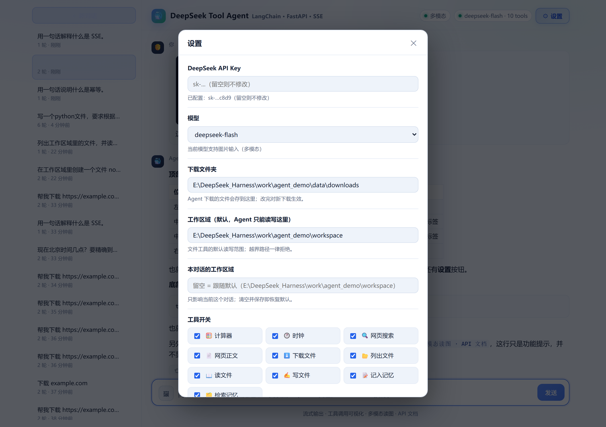 |

## 会话

会话消息（含图片）由 **LangGraph checkpointer + `AsyncSqliteSaver`** 落盘，会话元数据（标题 / 轮数 /
最近活跃 / 分组 / 工作区域）单独一张表。重启服务后列表、历史、图片、待批准的请求都还在。
左图是多会话侧边栏，右图是切回历史会话（图片一起恢复）：

| 会话列表 | 历史回放 |
| --- | --- |
| 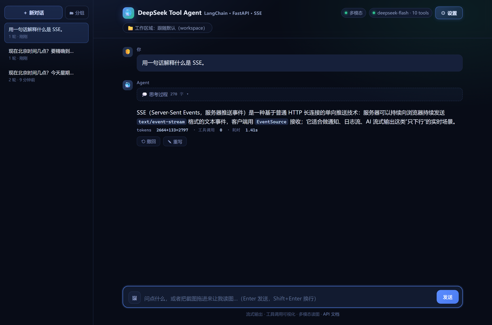 | 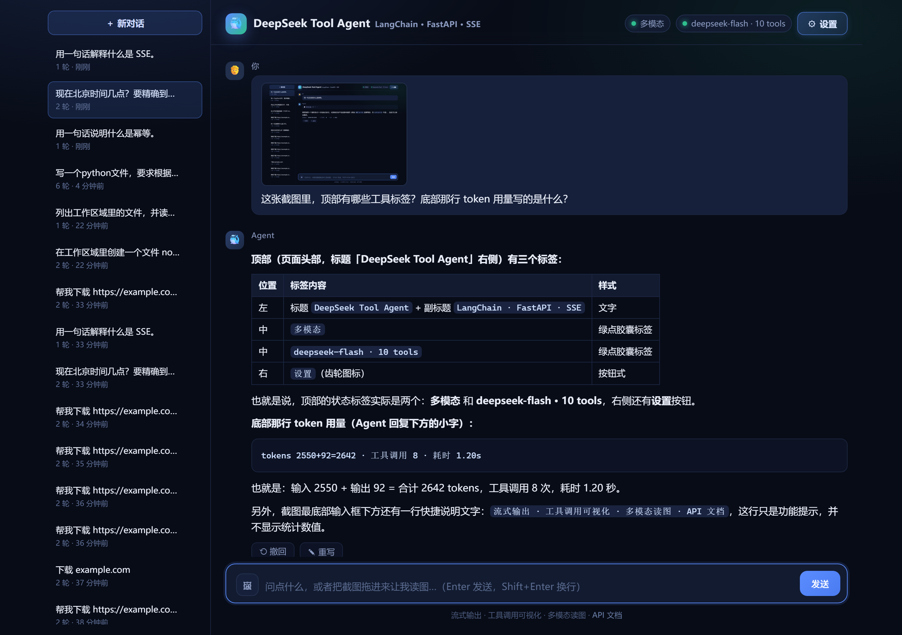 |

### 会话分组

每个对话行的标题右侧有一个 **···** 菜单（悬停出现，点开是浮层）：

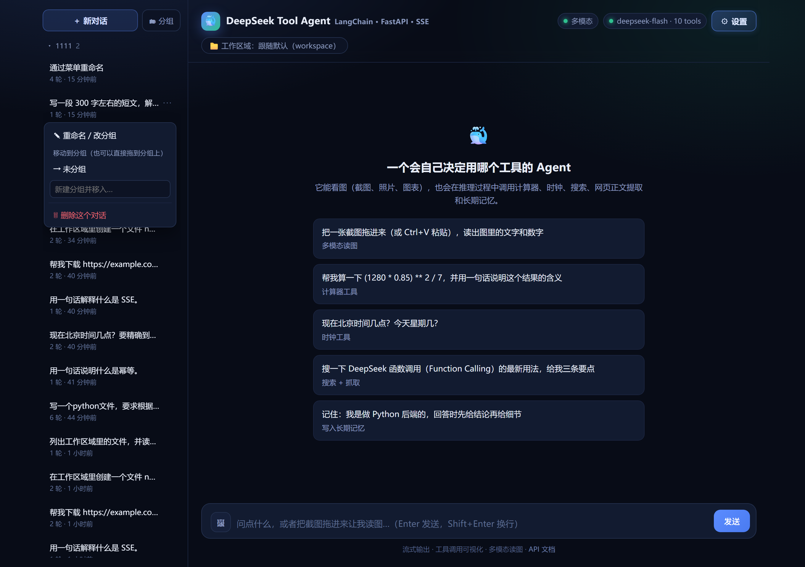

- **✎ 重命名 / 改分组**：内联编辑器，标题与分组一次 PATCH 提交
- **移动到分组**：直接列出目标；也可以**把对话行拖到分组标题上**，拖过去时标题会高亮提示
- **🗑 删除**

顶部「🗂 分组」可新建空分组；分组标题可折叠（状态记在 localStorage，刷新后保持）。

分组标题右侧也有一个 **···** 菜单，分组自己能做的事都在里面：

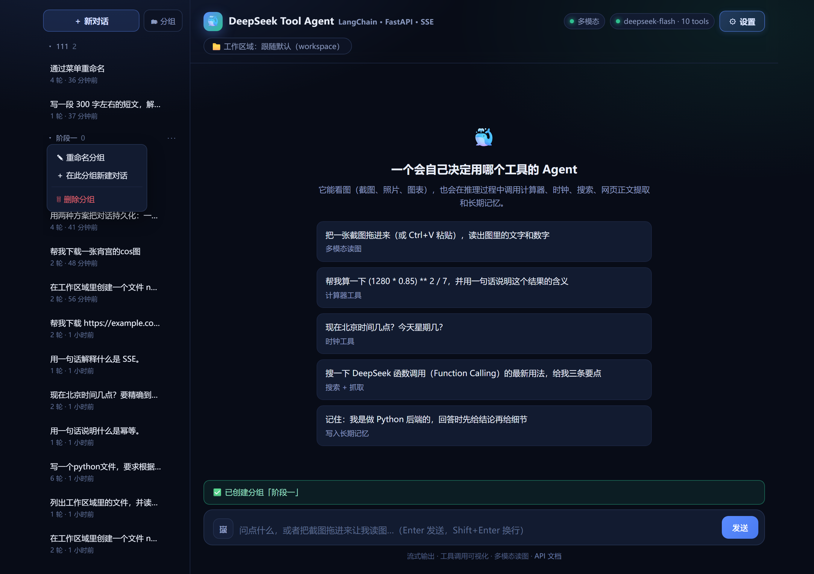

- **✎ 重命名分组**：就地改名，组里的对话一起跟着改（重名会被拒绝，不会静默合并）
- **＋ 在此分组新建对话**：新会话直接以该分组为家，不必事后拖拽
- **🗑 删除分组**：对话回到「未分组」，**分组本身进回收站，可一键恢复**

侧边栏底部常驻一个「🗄 已删除的分组」抽屉，恢复时把当时的成员一起放回：

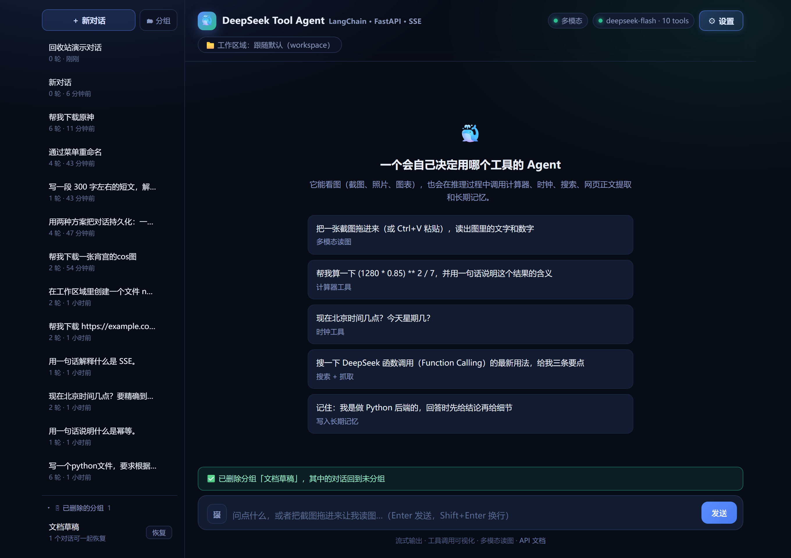

回收站存在 `groups_archive` 表（组名 + 成员快照 + 删除时间）。删除分组原本是不可逆的，
一次误点就会丢掉整个归类，所以改成"先归档再删"。

拖到「未分组」即移出分组：

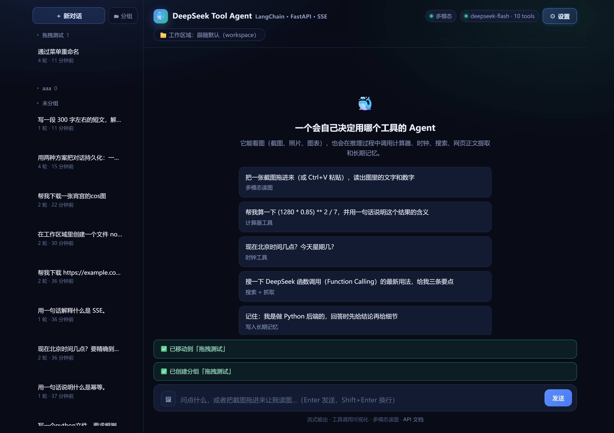

拖拽用的是原生 HTML5 drag & drop（`draggable` + `DataTransfer`），没有引入任何库；
触摸设备上走 `···` 菜单里的「移动到分组」，两种入口操作同一份后端状态。

## 工具的能力

| 工具 | 作用 | 需要批准 | 为什么需要它 |
| --- | --- | --- | --- |
| `calculator` | AST 白名单算术求值 | — | 模型心算不可靠；`eval` 不安全，这里逐节点白名单 + 指数上限 |
| `current_time` | 任意 IANA 时区的当前时间 | — | 模型不知道「今天」是几号，也不会算星期 |
| `web_search` | 免 Key 搜索（Bing / DuckDuckGo 双 provider + 熔断） | — | 时效性问题必须联网；单一上游不可靠 |
| `fetch_webpage` | 抓取网页并抽取正文 | — | 摘要不够时读全文；内置 SSRF 防护 |
| `download_file` | 下载文件到本地并给出下载链接 | ✅ | 唯一有副作用的网络工具 |
| `list_files` | 列出工作区域内的文件 | — | 先看有什么，再决定读哪个 |
| `read_file` | 读取工作区域内的 UTF-8 文本 | — | 读代码/笔记/CSV，大小与编码都受控 |
| `write_file` | 在工作区域里创建/覆盖文本文件 | ✅ | 唯一写磁盘的工具，必须用户点头 |
| `save_note` | 写入 SQLite 长期记忆 | — | 会话记忆有 TTL，跨会话偏好要落库 |
| `search_notes` | 检索长期记忆 | — | 让「记住我」真的成立 |

<details>
<summary>工具调用详情（入参 / 返回 / 单次耗时）</summary>

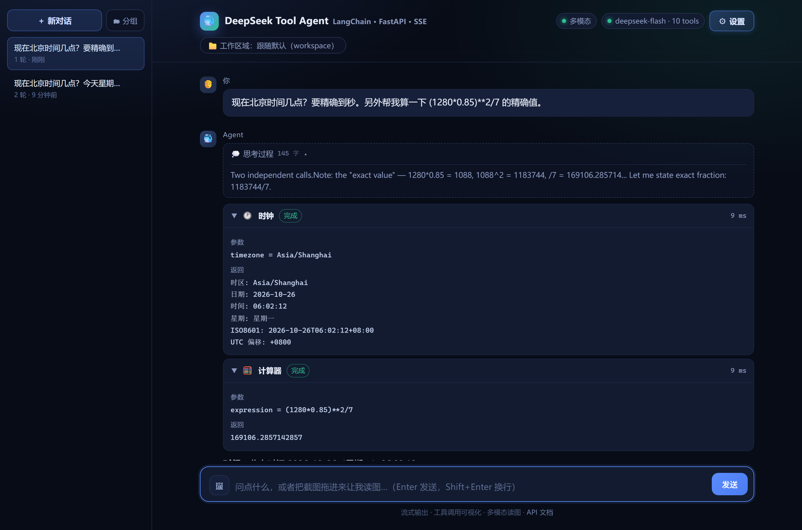

</details>

## 会给出方案选项

需要用户拍板时，模型会在回答末尾附一个 `options` 代码块；界面把这一块**从正文里摘掉**，
渲染成可点击的选项 —— 点一项就把那句话作为下一轮消息发出去；也可以在最下面的输入框里
写自己的方案。选项在流式过程中是隐藏的，不会出现半个代码块的闪烁：

| Agent 给方案 | 点了其中一个 |
| --- | --- |
| 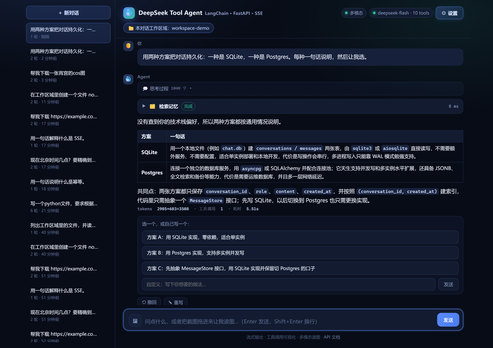 | 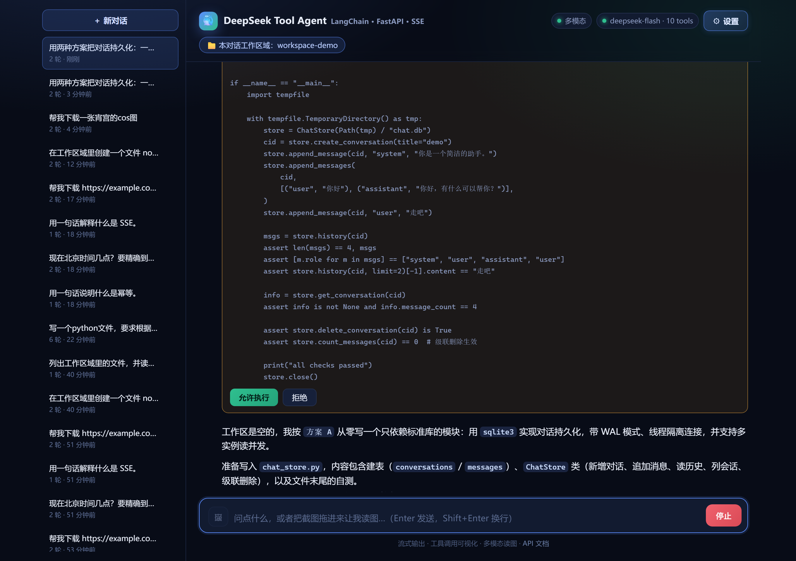 |

协议本身只是提示词里的一段约定（`options` 里的 JSON 数组，每项是一句可直接执行的指令），
前端做了容错解析（JSON 解析失败时退化为逐行读取），历史回放时这些选项以只读形式还原。

## 撤回与重写

聊错了不用重开对话。每轮回答下面都有两个按钮：

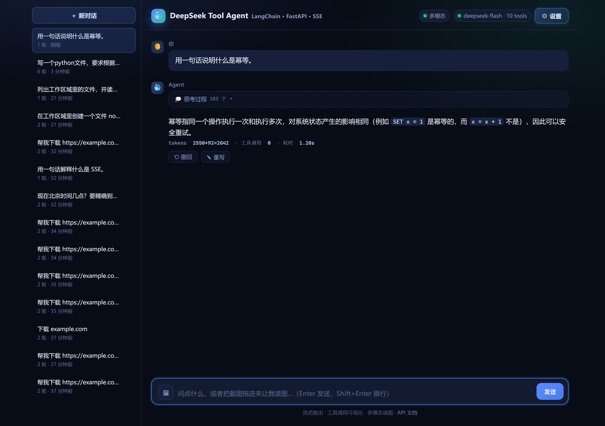

- **⟲ 撤回**：把最后一轮（提问 + 回答 + 其中的工具调用）从会话状态里删掉，轮数同步减一
- **✎ 重写**：把上一条提问（含图片）填回输入框并进入重写模式，改完发送就**替换**那一轮，而不是再追加一轮

实现走的是 LangGraph 的 `RemoveMessage` + `aupdate_state`：找到最后一条 `HumanMessage`，
把它和它之后的消息一起移除，再正常跑一轮。有挂起的审批时撤回会被拒绝（409），
避免把"等待决定"的状态删掉一半。

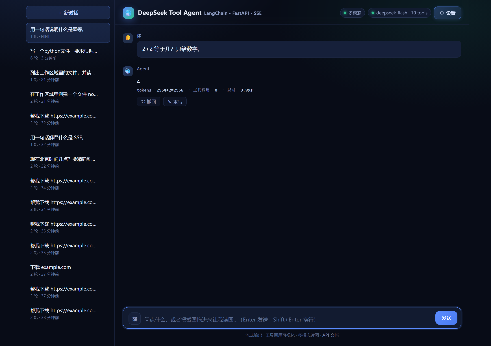

## 本地文件读写

文件工具能读写本地文件，但**只能在工作区域（workspace）里**。这个目录在设置面板里可以改，
默认是项目下的 `workspace/`。写文件同样走审批：模型说"我要写哪个文件"，你点「允许执行」才落盘，
写完后卡片外露出下载按钮：

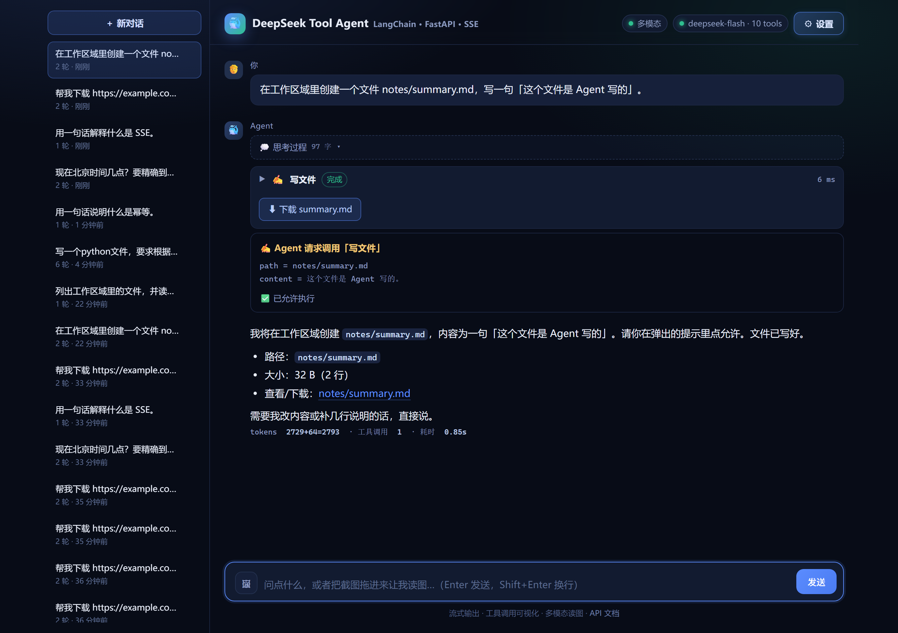

沙箱规则写在工具里：

- **一个根**：所有路径先 `resolve()` 再判断是否在根内，`../`、绝对路径、指向外面的符号链接
  全部拒绝（有单测覆盖，含 symlink 逃逸用例）
- **读免费、写审批**：读文件不打扰你；`write_file` 被 `HumanInTheLoopMiddleware` 拦住
- **双向限额**：读 ≤1MB、写 ≤2MB，二进制文件与非法编码直接拒绝并说明原因
- **能取回**：写好的文件通过 `GET /api/workspace/{path}` 读回/下载，前端直接给按钮

**每个对话还能单独指定工作区域**，入口就放在对话顶部那条工作区域标签里（不在全局设置里）：
点一下就地改，留空即恢复跟随默认。做法是把解析后的路径放进该轮次的 LangGraph
`configurable.workspace`，文件工具从运行上下文里读，所以同一个进程里两个对话可以各写各的目录，
不需要按会话重建图。

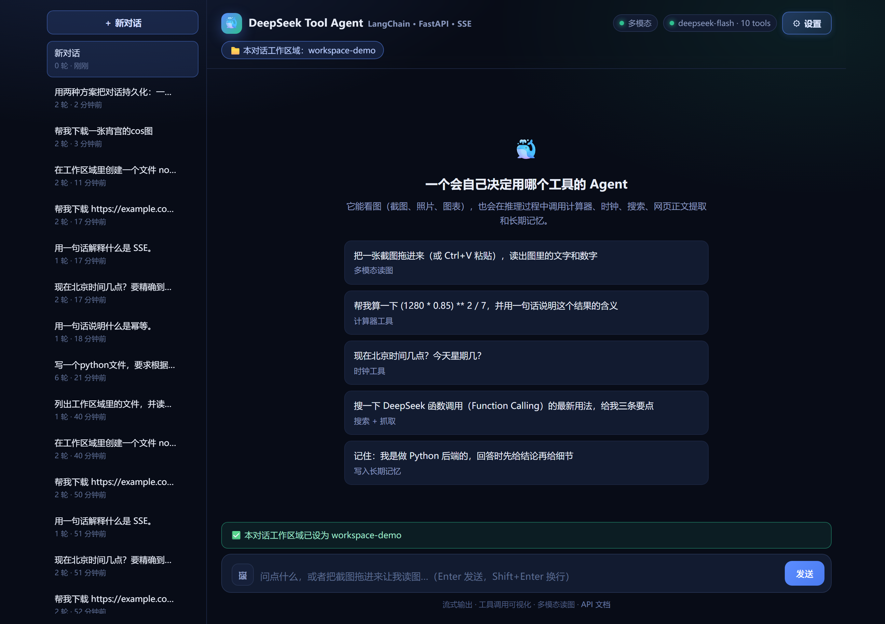

生产级替代方案（若要多用户）是换容器/微虚拟机隔离；这里的定位是本机单人使用，
所以用"根目录约束 + 写审批"来换取可演示性和低运维成本。


## 架构

```
浏览器（单页 HTML，零依赖）
  │  POST /api/chat/stream  {message, images[], session_id}
  ▼
FastAPI 路由 —— app/api/routes.py
  · pydantic 校验：消息长度、session_id、图片 MIME/张数/体积
  · StreamingResponse，media_type=text/event-stream
  │  产出 AgentEvent（与传输方式解耦）
  ▼
AgentService —— app/agent/service.py
  · create_agent() 组装 ReAct 图（LangGraph）
  · astream 事件 → token / reasoning / tool_call / tool_result / approval_required / usage
  · 会话元数据登记 + TTL 回收；热重建（reload）前等待在跑的回合结束
  │
  ├── model 节点 ──▶ ChatDeepSeek ──▶ api.deepseek.com
  ├── tools 节点 ──▶ 10 个工具 ────▶ Bing / 网页 / SQLite / 下载目录 / 工作区域
  └── HumanInTheLoopMiddleware ──▶ 命中 download_file / write_file 就 interrupt，等用户决定
```

一轮对话（含审批）的实际形状：

```
用户输入 ─▶ model ─有 tool_calls─▶ [需要批准? ─是─▶ interrupt → 前端批准/拒绝 → Command(resume)]
                                    └─否─▶ tools ─▶ model ─无 tool_calls─▶ 输出
```

## 快速开始

需要 Python 3.11+ 和 [uv](https://docs.astral.sh/uv/)。

```bash
uv sync                      # 装依赖（含开发依赖）
cp .env.example .env         # 填入 DEEPSEEK_API_KEY（也可以在界面设置里填）
uv run python -m app         # 地址与端口读 .env 的 APP_HOST / APP_PORT
```

打开 <http://127.0.0.1:8000> 是聊天界面，<http://127.0.0.1:8000/docs> 是自动生成的 API 文档。

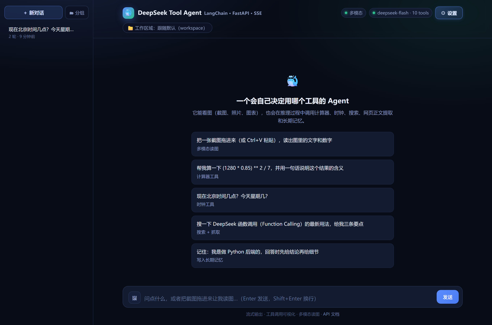

**没有 API Key 也能跑**：`MOCK_LLM=1` 会用内置假模型把 HTTP + SSE + 前端整条链路跑起来
（测试就是这么跑的），只是不真的调用 DeepSeek。

Docker：

```bash
cp .env.example .env
docker compose up --build     # 会话库、长期记忆、下载文件都落在 agent-data 卷里
```

## 启动与停止

它就是一个普通的 ASGI 进程：**前台启动，`Ctrl+C` 就是关闭**。推荐的入口是 `python -m app`，
地址与端口来自配置文件：

```powershell
cd <项目目录>              # 含 pyproject.toml 的那个目录
uv run python -m app
# 监听 APP_HOST / APP_PORT（.env 里配置，默认 127.0.0.1:8000）
# 浏览器打开 http://127.0.0.1:8000 ；结束：在这个终端里按 Ctrl+C
```

换端口就改 `.env`：

```dotenv
APP_HOST=127.0.0.1     # 想让同一局域网访问改成 0.0.0.0
APP_PORT=9000
```

也可以一次性覆盖，或走开发模式：

```powershell
uv run python -m app --port 9000        # 临时换端口
uv run python -m app --host 0.0.0.0     # 临时对外开放
uv run python -m app --reload           # 改代码自动重启
```

> 直接用 `uv run uvicorn app.main:app --port 8000` 同样能运行，但那条路径的端口只认命令行，
> 不读 `.env`。


Docker 方式：

```bash
docker compose up --build     # 前台，Ctrl+C 停
docker compose down           # 停掉并移除容器（数据在 agent-data 卷里，不会丢）
```

> 关于 API Key：`.env` 里默认是占位符。如果你在系统里设置了 `DEEPSEEK_API_KEY`
> 环境变量，它的优先级高于 `.env`；否则请把真 key 写进 `.env`，或直接在界面「⚙ 设置」里填
> （会写到 `data/settings.json`，优先级最高）。


```bash
# 新机器（或新目录）上
uv sync
cp .env.example .env                  # 填 key，或直接设 DEEPSEEK_API_KEY 环境变量
uv run python -m app                  # 端口由 APP_PORT 决定（默认 8000）
```

## API

| 方法 | 路径 | 说明 |
| --- | --- | --- |
| `POST` | `/api/chat/stream` | SSE 流式对话 |
| `POST` | `/api/chat` | 同一执行路径，聚合后一次性返回 |
| `POST` | `/api/sessions/{id}/resume` | 批准 / 拒绝挂起的工具调用，继续该轮（SSE） |
| `GET` | `/api/sessions/{id}/pending` | 当前待批准的请求（刷新页面后恢复用） |
| `GET` | `/api/sessions` | 会话列表（标题 / 轮数 / 最近活跃） |
| `GET` | `/api/sessions/{id}/messages` | 回放历史（含图片；`include_tools=true` 看工具消息） |
| `PATCH` | `/api/sessions/{id}` | 改标题 / 分组 / 独立工作区域（一次可改多项） |
| `GET` | `/api/groups` | 分组列表（含每个分组的对话数） |
| `POST` | `/api/groups` | 新建空分组 |
| `PATCH` | `/api/groups/{name}` | 重命名分组（组内对话一起改名） |
| `GET` | `/api/groups/trash` | 已删除但可恢复的分组 |
| `POST` | `/api/groups/restore` | 恢复分组，连同当时的成员 |
| `DELETE` | `/api/groups/{name}` | 删除分组（进回收站，可恢复） |
| `POST` | `/api/sessions/{id}/undo` | 撤回最后一轮 |
| `POST` | `/api/sessions/{id}/rewrite` | 用新内容重写最后一轮（SSE） |
| `DELETE` | `/api/sessions/{id}` | 删除会话（消息 + 列表项） |
| `GET` | `/api/files/{name}` | 取回 Agent 下载的文件（附件下载） |
| `GET` | `/api/workspace/{path}` | 读取 / 下载工作区域里的文件 |
| `GET` | `/api/settings` | 当前配置（API Key 只返回掩码） |
| `PATCH` | `/api/settings` | 改配置并热重建 Agent |
| `GET` | `/api/tools` | 工具注册表（含 enabled / requires_approval） |
| `GET` | `/api/health` | 就绪状态、模型、是否支持图片、活跃会话数 |

SSE 事件（`event: <type>` + `data: <json>`）：

| 事件 | 载荷 | 时机 |
| --- | --- | --- |
| `start` | `session_id, model, mock, images` | 开始处理 |
| `token` | `text` | 增量文本 |
| `reasoning` | `text` | 推理模型的思考片段 |
| `tool_call` | `id, name, label, icon, args` | 模型决定调用工具 |
| `approval_required` | `id, tool, label, args, description` | 该调用需要用户批准 |
| `tool_result` | `id, name, status(ok/error/rejected), content, elapsed_ms` | 工具执行完毕 |
| `usage` | `input_tokens, output_tokens, total_tokens, tool_calls, elapsed_ms` | 本轮结算 |
| `error` / `done` | `message` / `session_id, awaitable? awaiting_approval` | 结束 |


## 几个刻意做的取舍

**1. 事件流与传输解耦。** `AgentService` 只产出 `AgentEvent`，不知道 HTTP 存在。
SSE 端点、聚合式 REST、单元测试共用同一条执行路径——所以测试能用假模型把整条链路跑完。

**2. 危险操作走 LangGraph 的 interrupt，而不是"前端拦一下"。** 批准状态存在 checkpointer 里，
服务端是真正的关卡：没有 `Command(resume=...)` 这张图就不会继续，刷新页面也丢不掉这个请求。

**3. 热重建前先等在跑的回合。** 改模型/开关工具要重编译图并换掉 SQLite 连接，
所以 `reload()` 会先等 `in_flight` 归零（上限 30s）——否则会把正在流式输出的回合掐死。

**4. 图片在浏览器端压缩。** 340KB 截图直接 base64 就是 450KB 请求体，还白占 token。
canvas 缩到长边 1280 转 JPEG 再上传，后端独立校验 MIME/张数/体积（按 base64 长度估算，不用先解码）。

**5. 文件名只允许 ASCII。** 下载文件名同时要出现在 `GET /api/files/{name}` 的路径里，
所以工具端的清洗规则与路由正则 `[A-Za-z0-9._-]` 保持一致，加上 8 位内容哈希防重名。

**6. 前端渲染是幂等的。** 批准后图会重放 model 节点的 update，同一 `tool_call` 会再来一次；
前端按 call id 去重，否则会出现一张永远转圈的卡片。（这个 bug 是浏览器实测发现的。）

**7. 会话记忆用 checkpointer，元数据用一张小表。** 消息/图片交给 LangGraph，
标题/轮数/最近活跃落在 `sessions` 表；checkpointer 不解内存，所以另有 TTL + 容量回收。

**9. 切走对话不会掐断正在生成的那一轮。** 生成状态是**按会话**记的（`sessionId → controller`），
切走只是停止往界面画、继续把 token 收进缓冲区；回合跑完照常写进历史，切回来就能看到。
只有「停止」按钮和删除会话会真的中断它。


## 测试

```bash
uv run pytest          # 195 passed（1 个 symlink 用例在无权限的 Windows 上跳过）
uv run ruff check .    # All checks passed!
```

- `tests/test_tools.py` — 工具行为：算术精度、非法表达式、时区容错、记忆读写与隔离
- `tests/test_web_tools.py` — SSRF 白名单、正文抽取、provider 回退与熔断（不联网）
- `tests/test_download_tool.py` — 文件名清洗、危险目标拒绝、体积上限、成功输出形状
- `tests/test_approval.py` — 审批闸门：拦截 → 批准才执行 → 拒绝不执行 → 文件可取回
- `tests/test_settings.py` — 掩码、热重建、工具开关、下载目录校验、重载后会话还在
- `tests/test_agent_loop.py` — 脚本化假模型驱动的完整 ReAct 循环、多模态消息、失败收尾
- `tests/test_api.py` — HTTP 契约：SSE 帧序列、图片校验、会话列表与删除


## 目录

```
app/
├── __main__.py             # 启动入口：uv run python -m app（读 APP_HOST / APP_PORT）
├── main.py                 # 应用工厂、生命周期、请求日志、静态托管
├── core/
│   ├── config.py           # pydantic-settings，所有开关集中在此
│   ├── settings_store.py   # 运行时设置：data/settings.json + 掩码 + 热重载
│   └── logging.py          # 日志格式 + 密钥脱敏
├── agent/
│   ├── service.py          # ★ 图组装、事件归一化、审批中断/恢复、持久化、热重建
│   ├── llm.py              # DeepSeek 模型构造 + 离线假模型 + 图片能力判断
│   ├── prompts.py          # System Prompt（按启用的工具渲染）
│   └── tools/              # 十个工具，一个文件一组（download/write 在审批闸门后面）
├── api/
│   ├── routes.py           # 路由（薄：校验 / 委派 / 序列化）
│   └── schemas.py          # 请求响应模型 + 图片校验
└── static/index.html       # 单页前端：会话栏、审批卡片、图片压缩、设置面板、Markdown
tests/                      # 195 个离线测试
data/                       # 运行时数据（gitignored）：settings.json / 两个 sqlite / downloads
workspace/                  # 文件工具的工作区域（gitignored，可在设置里改）
Dockerfile / docker-compose.yml / .env.example
```
